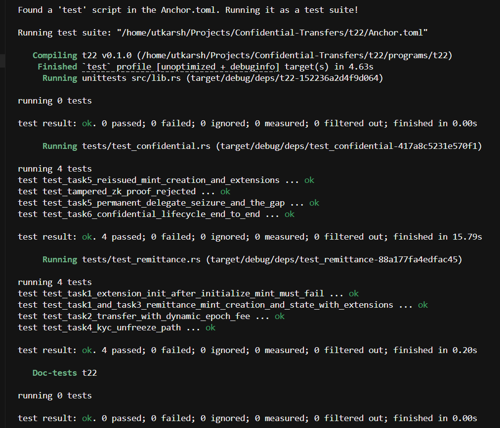
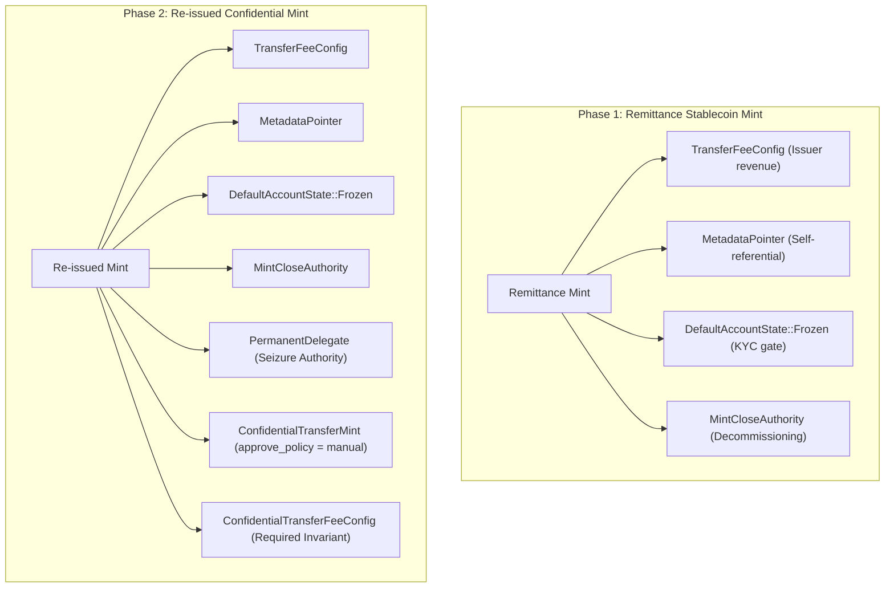
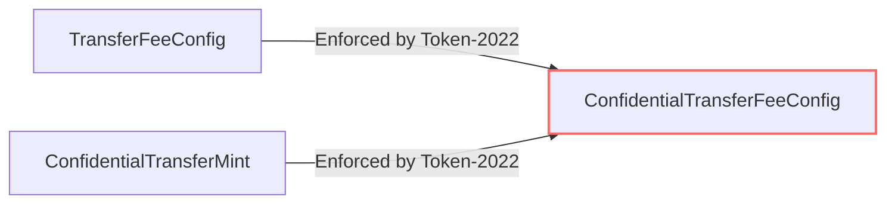
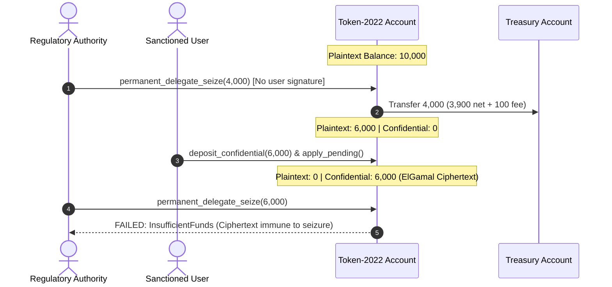
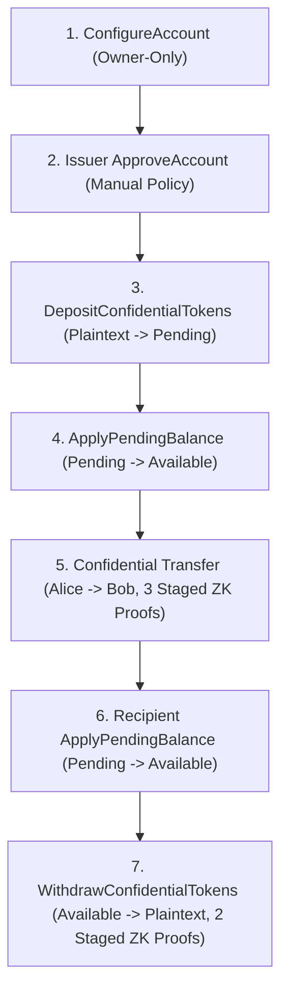

# Compliant Remittance Stablecoin & Confidential Transfers (SPL Token-2022)

An enterprise-grade Solana remittance stablecoin built with SPL Token-2022 extensions, implementing protocol-level fees, strict KYC account-state gating, mint decommissioning authority, dynamic fee recalculation, and a confidential re-issuance lifecycle that pairs privacy with regulatory seizure compliance.

---

## Verification & Test Results

All unit and integration tests across the remittance pipeline, regulatory seizure paths, and zero-knowledge confidential transfer lifecycles pass with full verification:



---

## System Architecture & Core Requirements

The protocol is designed around two core phases:
1. **The Remittance Stablecoin**: Enforces issuer revenue, mandatory KYC gating before account readiness, on-chain verifiable metadata, and decommissioning controls.
2. **The Re-issued Confidential Mint**: Extends the original token set with zero-knowledge ElGamal confidentiality and permanent delegation, formalizing the architectural boundaries between private balances and regulator-mandated seizure authorities.



---

## 1. Remittance Stablecoin Mechanics

### Dynamic Mint Sizing & Ordering Discipline
Token-2022 stores extension state in Type-Length-Value (TLV) entries immediately after the base 82-byte mint layout. Attempting to hardcode account length leads to account truncation or rent miscalculation.
- **Dynamic Sizing**: Space is calculated dynamically via `ExtensionType::try_calculate_account_len::<MintState>(&extensions)`, ensuring exact byte allocation (387 bytes for the remittance mint).
- **Ordering Invariant**: In Token-2022, every extension initialization instruction (`transfer_fee_initialize`, `metadata_pointer_initialize`, `default_account_state_initialize`, `mint_close_authority_initialize`) must be executed **strictly before** the final `InitializeMint2` instruction. Calling `InitializeMint2` seals the base mint header; any subsequent extension-init instruction fails immediately with `InvalidAccountData`.

### Dynamic Epoch Fee Calculation
Transfer fees cannot be calculated using static or cached parameters. Network epochs determine active fee basis points and maximum caps.
- The transfer instruction unpacks `TransferFeeConfig` directly from account data.
- The expected fee is computed dynamically using:
  $$\text{fee} = \text{calculate\_epoch\_fee}(\text{Clock::get}()?.\text{epoch}, \text{transfer\_amount})$$
- The computed fee and mint decimals are passed into `transfer_checked_with_fee`. If the client passes an unexpected or stale fee value, Token-2022 aborts the transaction.

### Strict `StateWithExtensions` Inspection
Raw account deserialization (`unpack` or `unpack_unchecked`) parses only the base 82-byte mint or 165-byte token account struct, completely discarding the TLV extension segment.
- All state inspections exclusively use `StateWithExtensions::<MintState>::unpack` and `StateWithExtensions::<TokenAccountState>::unpack`.
- Extension instances (`TransferFeeConfig`, `DefaultAccountState`, `PermanentDelegate`, `ConfidentialTransferAccount`) are retrieved through type-safe queries on `StateWithExtensions`, preserving security guarantees across CPI boundaries.

### KYC Gating via `DefaultAccountState` & Individual Thawing
Remittance stablecoins require strict compliance: unvetted accounts must never be allowed to receive or transfer funds until their identity clears verification.
- **Default State**: The mint is initialized with `DefaultAccountState::Frozen`. Every new token account created under this mint is born in the `Frozen` state.
- **Individual KYC Thaw**: Once off-chain KYC is verified, the designated freeze authority invokes `thaw_account`.
- **State Invariance**: Thawing an individual account mutates only that account's `state` field (from `AccountState::Frozen` to `AccountState::Initialized`). The mint's `DefaultAccountState` remains permanently `Frozen`, guaranteeing that subsequent new accounts are still born frozen.

---

## 2. Re-issuance, Seizure Authority, and The Architectural Gap

Token-2022 confidential transfer extensions cannot be added to a mint after its initial creation. To fulfill regulatory mandates requiring seizure capabilities alongside privacy demands, the mint is re-issued carrying forward all previous extensions while incorporating `PermanentDelegate` and `ConfidentialTransferMint`.

### The Token-2022 Coexistence Invariant
When a mint carries `TransferFeeConfig` and confidentiality is added, Token-2022 enforces a strict architectural invariant in `extension/mod.rs`:
```
if transfer_fee_config && confidential_transfer_mint && !confidential_transfer_fee_config {
    return Err(TokenError::InvalidExtensionCombination); // Error 0x33
}
```
A cleartext fee cannot be computed on an encrypted confidential transfer amount. Therefore, Token-2022 structurally mandates the inclusion of `ConfidentialTransferFeeConfig` (with an ElGamal authority key), expanding the re-issued mint to **625 bytes** across 7 stacked extensions.



### PermanentDelegate Plaintext Seizure
The `PermanentDelegate` extension assigns a protocol authority capable of executing `transfer_checked` and `burn_checked` on any token account without the token holder's signature.
- On plaintext token balances (`base.amount`), the designated seizure authority invokes `permanent_delegate_seize`.
- The seized funds are transferred directly into a regulatory treasury without requiring the sanctioned user's keypair.
- Any applicable transfer fee configured under `TransferFeeConfig` is automatically calculated and withheld into the destination account's `TransferFeeAmount` extension.

### The Regulatory & Architectural Gap
There is a fundamental cryptographic disconnect between `PermanentDelegate` and confidential balances:



1. **Jurisdiction Boundary**: `PermanentDelegate` operates strictly on plaintext `base.amount`. It possesses no cryptographic or instruction-level mechanism to decrypt, transfer, or burn twisted ElGamal ciphertexts stored in `ConfidentialTransferAccount`.
2. **Mathematical Immunity**: Confidential balances can only be debited with zero-knowledge validity and range proofs constructed using the holder's ElGamal secret key and AES encryption key.
3. **Issuer Mitigations**:
   - **`approve_policy = manual` (`auto_approve_new_accounts = false`)**: The issuer must explicitly sign `ct_ix::approve_account` before any confidential operations are enabled. Sanctioned wallets are denied approval up front.
   - **Freeze Authority**: Freezing the token account halts all public transfers, confidential deposits, and confidential transfers. This locks the funds in place permanently, preventing illicit movement, though it does not confiscate the shielded balance.

---

## 3. End-to-End Confidential Transfer Lifecycle

The confidential lifecycle is executed across distinct, zero-knowledge verifiable stages:



### 1. ConfigureAccount (Owner-Only)
- Account configuration generates ElGamal and AES keys from the owner's signature via HKDF-SHA512.
- Accompanied by a `PubkeyValidityProof` verifying the ElGamal public key.
- **Strictly Owner-Only**: Token-2022 enforces that only the token account owner can sign `configure_account`. Any third party or attacker attempting to configure another user's account is rejected with an authority mismatch.
- Because `auto_approve_new_accounts = false`, the account initializes with `approved = false`.

### 2. Manual Approval Enforcement
- Until approved by the mint authority, any attempt to deposit or transfer confidential tokens fails.
- The issuer invokes `ct_ix::approve_account`, activating the account for confidential operations.

### 3. DepositConfidentialTokens
- Plaintext tokens held in `base.amount` are converted into confidential storage.
- Plaintext balance drops to 0, and the deposited value is credited to the ElGamal-encrypted `pending_balance`.

### 4. ApplyPendingBalance
- Token-2022 segregates incoming funds into `pending_balance` to prevent front-running discrete-log decryption.
- The owner decrypts pending, computes the updated total, encrypts it under their AES key, and submits `apply_pending_balance` to move funds into `available_balance`.

### 5. Confidential Transfer with Staged ZK Proofs
A confidential transfer requires proving that the sender has sufficient balance and that ciphertexts are valid, without revealing the transfer amount:
- **3 Staged Zero-Knowledge Proofs**:
  1. `VerifyCiphertextCommitmentEquality`: Proves the encrypted amount equals the commitment.
  2. `VerifyBatchedGroupedCiphertext3HandlesValidity`: Proves ciphertexts are valid under sender, recipient, and optional auditor keys.
  3. `VerifyBatchedRangeProofU128`: Proves amounts are non-negative and within valid range limits.
- **Proof Staging into Context Accounts**: Because the 3 zero-knowledge proofs exceed Solana's 1232-byte MTU transaction size, each proof is pre-verified into a dedicated `zkif` context state account.
- The transfer instruction references these pre-verified accounts via `ProofLocation::ContextStateAccount`.
- Once verified on-chain, proof context accounts are closed to reclaim rent lamports.

### 6. Recipient Pending Balance Application Prior to Withdrawal
- Transferred tokens land in the recipient's `pending_balance`.
- Before the recipient can withdraw any shielded funds, they must execute `apply_pending_balance` to roll the incoming pending ciphertext into `available_balance`.

### 7. WithdrawConfidentialTokens Back to Plaintext
- The recipient moves shielded tokens back to public cleartext `base.amount`.
- Verified using 2 staged ZK proofs:
  1. `VerifyCiphertextCommitmentEquality`
  2. `VerifyBatchedRangeProofU64`
- Decreases confidential `available_balance` and increases plaintext `base.amount`.

---

## 4. Codebase Organization

The program is organized into cohesive modules without unnecessary abstraction layers:

```
programs/t22/
├── Cargo.toml
└── src/
    ├── lib.rs                     # Anchor entrypoint: instruction router & program declaration
    ├── constants.rs               # Protocol constants (AE_CIPHERTEXT_LEN)
    ├── error.rs                   # Domain error definitions (RemittanceError)
    ├── instructions.rs            # Instruction module re-exports
    └── instructions/
        ├── remittance.rs          # Remittance mint creation, dynamic fee transfer, KYC thaw
        └── confidential.rs        # Reissued mint, confidential mint, seizure, deposit & apply
tests/
├── test_remittance.rs             # Tasks 1–4: Sizing, Ordering, Dynamic Fee, StateWithExtensions, KYC Thaw
└── test_confidential.rs           # Tasks 5–6: Re-issuance, Seizure gap, Staged ZK proofs & full lifecycle
```

### Instruction Mapping

| Instruction Handler | File Location | Key Extensions / Mechanisms Used |
| :--- | :--- | :--- |
| `create_remittance_mint` | [`instructions/remittance.rs`](./programs/t22/src/instructions/remittance.rs) | `TransferFeeConfig`, `MetadataPointer`, `DefaultAccountState(Frozen)`, `MintCloseAuthority` |
| `transfer_with_fee` | [`instructions/remittance.rs`](./programs/t22/src/instructions/remittance.rs) | `calculate_epoch_fee`, `transfer_checked_with_fee`, `StateWithExtensions` |
| `thaw_account` | [`instructions/remittance.rs`](./programs/t22/src/instructions/remittance.rs) | KYC verification thaw via freeze authority without altering mint default state |
| `create_reissued_confidential_mint` | [`instructions/confidential.rs`](./programs/t22/src/instructions/confidential.rs) | Stacks 7 extensions, `PermanentDelegate`, manual approval policy (`auto_approve = false`) |
| `create_confidential_mint` | [`instructions/confidential.rs`](./programs/t22/src/instructions/confidential.rs) | Pure confidential mint initialization |
| `permanent_delegate_seize` | [`instructions/confidential.rs`](./programs/t22/src/instructions/confidential.rs) | `PermanentDelegate` seizure of plaintext tokens |
| `deposit_confidential` | [`instructions/confidential.rs`](./programs/t22/src/instructions/confidential.rs) | CPI into Token-2022 confidential deposit instruction |
| `apply_pending_balance` | [`instructions/confidential.rs`](./programs/t22/src/instructions/confidential.rs) | Rolls pending ElGamal ciphertexts into decryptable available balance |
